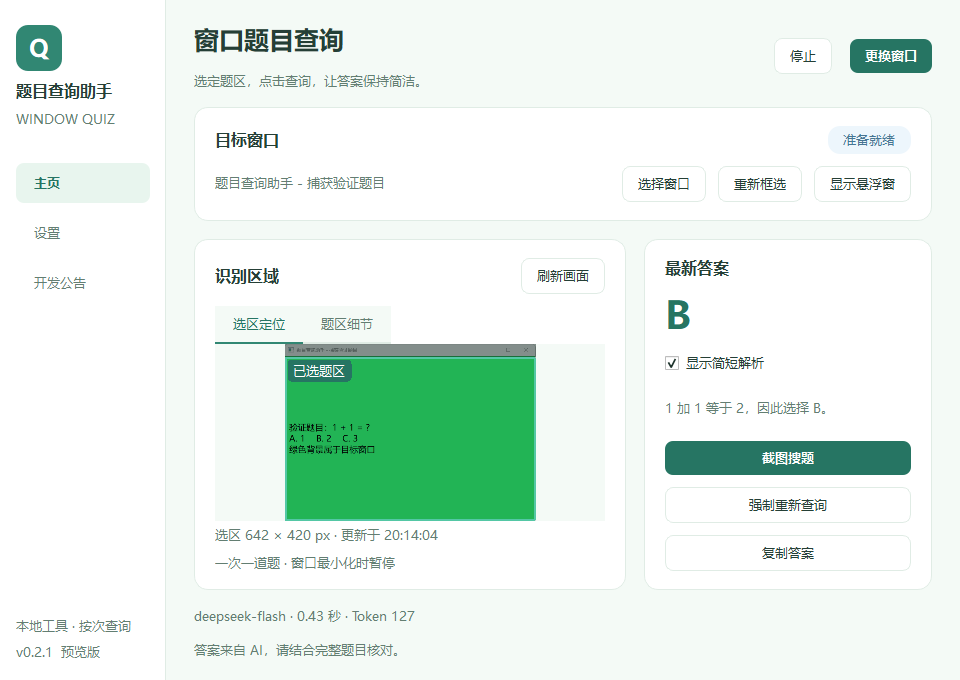
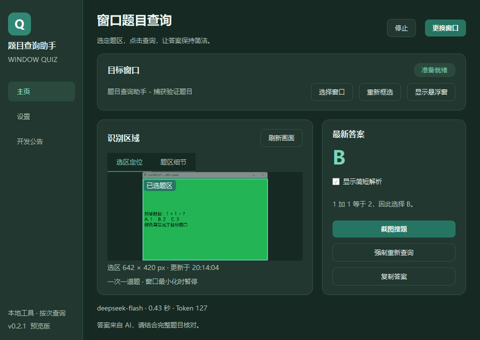
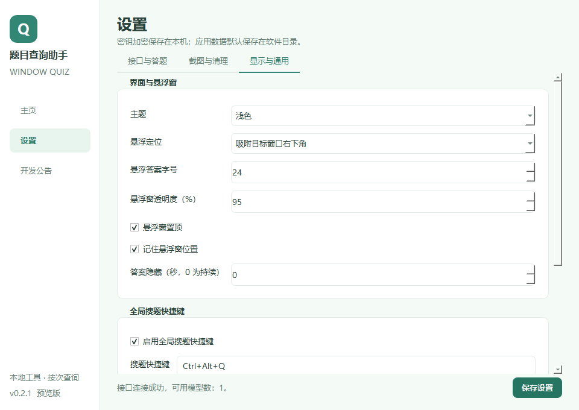

<div align="center">


# 题目查询助手

**选定窗口，框选题目，快捷获取 AI 答案。**

奶白与薄荷绿的 Windows 桌面小工具，让单选、多选、判断的查询保持简洁。


[**下载 Windows 便携版**](https://github.com/PowerT-0704/window-quiz-helper/releases/latest) · [快速开始](#使用便携版) · [开发路线](ROADMAP.md) · [更新日志](CHANGELOG.md) · [反馈问题](https://github.com/PowerT-0704/window-quiz-helper/issues)

</div>

<br>



<p align="center"><sub>界面预览使用自有模拟题目和本地 Mock 接口；图中的答案、耗时和 Token 仅为演示。</sub></p>

## 用起来是什么样

```text
开始运行 → 选择窗口 → 框选一道题 → Ctrl + Alt + Q → 悬浮显示答案
```

| 能力 | 使用体验 |
| :--- | :--- |
| 🪟 窗口独立捕获 | 普通窗口被遮挡时仍可捕获，最小化时暂停 |
| 🎯 直观题区预览 | 完整窗口高亮选区，题区细节支持放大、1:1 和适应 |
| 🌿 跟随式悬浮窗 | 吸附目标右下角，可拖开、恢复吸附、找回与复制 |
| ⌨️ 全局快捷搜题 | 默认 **Ctrl＋Alt＋Q**，支持自定义；忙碌时不重复提交 |
| ✨ 简洁答案 | 单选 `A`、多选 `A、C`、判断“正确／错误”，解析按需开启 |
| 🔐 本地密钥保护 | API Key 通过当前 Windows 用户的 DPAPI 加密保存 |
| 🧹 可控截图清理 | 任务结束后默认保留 10 分钟，支持自动和手动清理 |
| 🌗 浅色与深色 | 主页、设置、开发公告三个页面，配色与悬浮窗统一 |

<details>
<summary><strong>查看深色主题与设置界面</strong></summary>

### 深色主题



### 显示与通用设置



</details>

## 当前版本

一个通过窗口图片查询 AI 答案的 Windows 桌面工具。选择目标窗口、框选一道题，点击悬浮按钮后显示单选、多选或判断题答案；可选择附带简短解析。

当前版本：**0.2.1 预览版**。修复目标窗口重新置顶后盖住吸附悬浮窗的问题，增加主页“显示悬浮窗”找回按钮。采用奶白、薄荷绿与浅天蓝界面，支持全局快捷搜题、目标窗口吸附和完整选区预览。真实 DeepSeek 查询需在本地填写 API Key 后验收；Windows 10、混合 DPI 多屏仍待对应设备实测。

## 使用便携版

前往 [Releases](https://github.com/PowerT-0704/window-quiz-helper/releases/latest)，下载 **`window-quiz-helper-windows-x64-v0.2.1.zip`**。便携版无需安装 Python，API 服务需自行配置并承担费用。

1. 将整个 `题目查询助手` 文件夹解压到 **D／E 等非 C 盘可写目录**。保留 EXE 旁的 `_internal` 文件夹。
2. 双击 `题目查询助手.exe`，进入“设置”。默认接口为 `https://api.deepseek.com`，模型为 `deepseek-flash`。
3. 在本地输入 API Key 并保存。连接测试验证接口和凭据；真实图片查询以实际任务为准。不要把 Key 发到聊天、Issue 或 GitHub。
4. 回到主页，点击“开始运行”，选择目标窗口，在预览图中框选**一道题的完整题干与全部选项**。
5. 点击悬浮窗的“截图搜题”，或按 **Ctrl＋Alt＋Q**。需要解析时打开“显示简短解析”；答案可复制，重复图片可使用缓存，也可强制重新查询。

悬浮窗默认跟随目标窗口右下角，拖开后进入自由位置模式，点击“恢复吸附到目标窗口”即可重新跟随。目标最小化时暂停并隐藏悬浮窗，恢复后重新吸附。等待时可以“取消本次查询”，保留目标与选区。

找不到悬浮窗时，在主页目标窗口一栏点击“显示悬浮窗”。开启“悬浮窗置顶”时，软件会恢复悬浮窗自身的显示层级，不抢焦点；不会改变目标窗口的层级或显示状态。目标最小化时找回按钮禁用，恢复目标后再使用。

主页“选区定位”显示完整窗口并高亮选择框，“题区细节”可放大、缩小、1:1 或适应显示。选择题区、搜题和点击“刷新画面”时更新；刷新不调用 AI，空闲时不连续截图。

快捷键在“设置 → 显示与通用”中调整或关闭，支持 Ctrl／Alt／Shift 组合及 F1～F11。冲突时提示并保留原绑定；忙碌、暂停、未选题区或框选对话框打开时，不提交快捷键请求。无键盘钩子或目标进程注入。

升级时先退出旧版，在同一电脑和 Windows 账户下将旧版整个 `data` 文件夹复制到新版软件目录，即可保留 Key 和设置。旧 Token 字段兼容忽略，保存设置时移除；超时值与凭据不自动修改。截图目录也沿用原路径，可在设置中重新选择。若旧任务栏固定项目仍显示缓存图标，可解除旧固定项目并重新固定新版 EXE，软件不自动改动 Windows 图标缓存或任务栏配置。

窗口被其他窗口遮挡时仍使用独立窗口捕获；最小化时暂停，恢复后重新取得画面。窗口尺寸或 DPI 导致捕获尺寸变化后，需要重新框选。受保护窗口、特殊渲染画面或系统拒绝捕获时会明确报错，不会自动截取整个桌面。

## 三个页面

- **主页**：运行状态、目标窗口、题区预览、最新答案、解析开关、模型、耗时和实际 Token 用量。
- **设置**：接口和模型、加密凭据、题型、思考强度、解析、超时、PNG／JPEG、图片大小、截图目录与清理、悬浮窗定位及外观、全局快捷键、主题、代理和日志级别。
- **开发公告**：随软件附带的版本说明与已知限制，不包含在线更新。

默认低强度思考、关闭解析，保持 PNG 题区原图。**客户端不设置单题 Token 上限，不发送 max_tokens 参数。**服务商仍有默认生成限制，并非无限输出。升级保留现有请求超时，默认仍为 60 秒，可在设置中调整；不自动延长或取消等待时限。查询期间防止重复提交，不自动重试。通过只上传题区、不发送历史对话、简短结构化答案和最近一次结果缓存减少开销。

兼容接口须支持图片输入与 Chat Completions JSON 输出；仅一个当前接口配置。远程接口必须使用 HTTPS，本机回环地址可以使用 HTTP。自定义代理支持不含凭据的 `http://主机:端口` 或 `socks5://主机:端口`；需要认证的代理可由系统代理处理。

## 数据位置与清理

所有应用数据默认位于软件目录下的 `data`，不回退到 C 盘或系统临时目录：

```text
data/
  settings.json        普通应用设置，不含 API Key
  credentials.bin      当前 Windows 用户范围的 DPAPI 密文
  capture-index.json   本软件截图清理索引
  captures/            默认临时题区图片目录
  logs/                脱敏运行日志
```

截图任务结束后默认保留 10 分钟。支持修改时长、关闭自动清理和手动清理；下次启动补清理已过期截图。清理只处理本软件索引登记、身份匹配且不在使用中的图片，不会递归清空自定义目录。

DPAPI 通常绑定当前电脑与 Windows 登录账户，更换电脑或账户后重新输入 Key。这是静态存储加密，不能防御已经控制同一账户的程序。截图本身不加密，保留期间应按自己的数据要求管理。

查询时，题区截图会发送给**你配置的 AI 服务商**，请确认画面适合上传。仓库中的 `docs/images` 仅包含自有模拟界面，不包含用户实际题目或运行数据。

不保存答题历史；最新答案和最近一次查询缓存仅存在于当前会话内存。日志不记录 Key、请求头、图片 Base64 或完整 AI 响应。软件不向目标进程注入 DLL、不读取其内存，首版不模拟鼠标点击。

## 从源码运行

开发环境为 Windows 64 位、Python 3.14；依赖锁定 PySide6 6.12.0。工作目录须位于非 C 盘可写目录。

```powershell
git clone https://github.com/PowerT-0704/window-quiz-helper.git
cd window-quiz-helper
py -m venv .venv
$env:PIP_CACHE_DIR = "$PWD\.cache\pip"
$env:TEMP = "$PWD\.cache\temp"
$env:TMP = $env:TEMP
New-Item -ItemType Directory -Path $env:PIP_CACHE_DIR, $env:TEMP -Force | Out-Null
.\.venv\Scripts\python.exe -m pip install -r requirements-build.txt
powershell -ExecutionPolicy Bypass -File .\scripts\run.ps1
```

这些环境变量仅作用于当前 PowerShell 会话。无需 `.env` 文件，也不要将 Key 放入启动命令。

## 检查与打包

```powershell
.\.venv\Scripts\python.exe -m unittest discover -s tests -v
powershell -ExecutionPolicy Bypass -File .\scripts\build.ps1
.\.venv\Scripts\python.exe .\scripts\package_source.py
```

构建脚本默认先运行测试，使用目录式 PyInstaller 打包，缓存、构建产物和临时目录均设置在项目内。只收集实际用到的 Qt 模块，包含 QtMultimedia 的 FFmpeg 捕获插件，排除 WebEngine 与 PDF 模块；QtGui 钩子复用标准依赖收集，仅过滤未使用的 PDF 图片插件和虚拟键盘插件。

构建输出：`dist/v0.2.1/题目查询助手/题目查询助手.exe`。按版本区分输出目录，保留旧版产物。构建脚本同时附带文档及许可证。源码压缩包按白名单收集源码、图标、测试、脚本和文档，不含 `data`、Key、截图、虚拟环境、缓存或 Git 元数据。若同版本输出已经产生 `data`，构建脚本拒绝覆盖，避免删掉运行数据。

构建期间将 PATH 限定为项目 Python 与 Windows 系统目录，避免其他开发工具携带的同名 ICU／API-set DLL 混入发布包；脚本结束时恢复调用进程原值。

便携运行组件可离屏自检，不联网、不读取真实 Key，也不显示窗口或对话框：

```powershell
.\题目查询助手.exe --diagnose
Get-Content -LiteralPath .\data\diagnostics.json
```

`ok: true` 表示应用模块、Qt 窗口捕获接口、PNG 编码、DPAPI 和 TLS 后端自检通过；不等于已经完成真实窗口捕获或真实 API 答题验收。

## 验证状态与限制

v0.2.1 本轮 70 项自动检查，69 项通过，1 项符号链接权限跳过。原生自有置顶窗口复现测试覆盖被遮挡找回、隐藏／最小化找回和不抢焦点；另验证框选异常后继续跟随。原捕获、本地模拟接口、吸附、刷新、快捷键和取消流程继续通过。便携构建结果见 `DELIVERY.md`。

| 项目 | 状态 |
|---|---|
| 答案 JSON 校验、题型与异常响应处理 | 自动测试覆盖 |
| DPAPI 加解密、设置保存、清理边界与完成后保留 | 自动测试覆盖；虚构测试 Key，不使用真实凭据 |
| 异步请求、网络错误、超时、重复提交与任务失效 | 自动测试覆盖，具体数量见本轮交付报告 |
| Windows 11 普通 Qt／Chromium 静态遮挡捕获 | 实测 8 项通过，使用 WGC，无桌面回退 |
| 界面、缓存、解析、最小化恢复与停止取消 | 实际 WGC → 本地 Mock API → 主页／悬浮窗，6 条端到端流程通过；两种主题及各页截图已检查 |
| 便携运行组件 | 解压到 D 盘中文路径，移除 Python 环境并仅保留 Windows System32 的 PATH，EXE `--diagnose` 离屏检查通过；打包版实窗交互待验收 |
| 真实 DeepSeek 图片查询 | **待用户在本地配置 Key 后验收** |
| Windows 10、100%／150%／200% 和混合 DPI 多屏 | **待对应设备实机验收** |
| 受保护窗口、游戏及特殊渲染应用 | 不承诺通用兼容 |

模型可能给出错误答案，结构化校验只验证格式，不证明答案事实正确。完整画面变化、网络和模型负载会影响耗时。超时或取消后远端可能已经开始处理，因此不保证一定不计费。

Windows 10 1903+ x64 为适配目标，当前实测以 Windows 11 为准。

## 下一步

| 版本 | 方向 | 状态 |
| :--- | :--- | :--- |
| v0.2.1 | 界面、快捷搜题、窗口吸附与找回 | 已交付；部分兼容项待实机验收 |
| v0.2 后续 | 混合 DPI、窗口兼容性、延迟与包体积优化 | 规划中 |
| v0.3 | 用户确认后模拟点选、校准与紧急停止 | 未开始 |
| v0.4 | 画面变化检测、去重、受控连续任务与预算 | 未开始 |
| v0.5 | 按实测收益评估多接口、批量与可选本地 OCR | 未开始 |

完整计划见 [开发路线](ROADMAP.md)，检查证据与每轮文件清单见 [交付报告](DELIVERY.md)。反馈时请附版本、Windows 版本、缩放比例和脱敏后的复现步骤。请勿在 Issue 或提交中附带密钥。

## 许可说明

项目源码公开，**暂未授予统一的开源许可证**。第三方组件遵循各自许可，详见 [第三方说明](THIRD_PARTY_NOTICES.md) 和 [LICENSES](LICENSES/README.md)。
